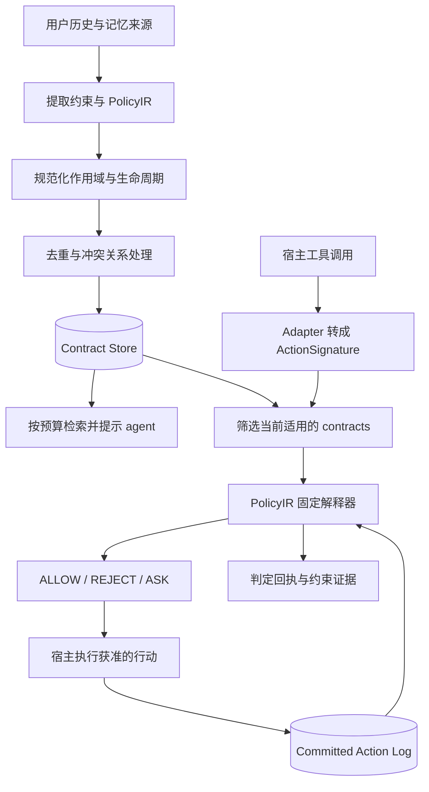

# Memory-as-Contracts (MAC)

MAC 将用户在历史交互中提出的行为约束，转成有作用域、生命周期和执行语义的 contract，并在 agent 行动时检查。Python 包名为 `memory_as_contracts`，CLI 为 `mac`。

本文按 motivation、系统设计、benchmark 三部分整理。**当前工作树采用 PolicyIR 执行链路，历史 Python validator 已移除，unified-ops extraction 默认关闭。** 分支整合与验证范围见[整合记录](docs/branch-consolidation.md)。下文中的历史方案与下一阶段计划均单独标明。

## 1. Motivation

用户对 agent 的要求经常跨越多轮对话：“这个项目不要上传云端”“发送前先核验收件人”“这次可以例外”。正确执行既需要记住要求，也需要判断它何时适用、是否已被修改，以及当前行动是否违反它。

普通记忆检索可以把相关文本放回上下文，但检索到某条旧要求，并不等于它现在仍然有效；把要求写进 prompt，也不能保证 agent 在工具调用时遵守。MAC 希望把这部分责任显式化：保存约束及其变化关系，计算当前有效集合，再根据实际工具调用和已执行的行动检查约束。

研究问题是：**如何将可修改、可撤销、有适用范围的历史用户指令，可靠地转成当前行动的约束？** 通用事实记忆与任务求解仍由宿主 agent 或其他 memory system 承担。

## 2. MAC 系统设计

### 2.1 总体架构

系统分为写入时的约束处理与行动时的执行检查。前者可以调用 LLM；后者通过固定解释器执行，不在 hook 中调用 LLM API。



主要模块：

| 模块 | 责任 | 实现入口 |
| --- | --- | --- |
| Extraction | 从用户文本提取 contract、工具目标和 PolicyIR | [extractor.py](src/memory_as_contracts/extractor.py) |
| Normalization / Resolution | 规范化 scope/lifecycle，处理重复、覆盖、冲突与例外关系 | [normalizers.py](src/memory_as_contracts/normalizers.py)、[resolver.py](src/memory_as_contracts/resolver.py) |
| Store | 保存 contracts、关系边、用户历史、行动与判定记录 | [store.py](src/memory_as_contracts/store.py) |
| Retrieval | 为 prompt 提供预算内的相关约束提示 | [retrieval.py](src/memory_as_contracts/retrieval.py) |
| Adapter / Hook | 将宿主调用映射为 ActionSignature，筛选适用规则并执行检查 | [adapters](src/memory_as_contracts/adapters)、[hook_plan.py](src/memory_as_contracts/hook_plan.py) |
| PolicyIR / Action Log | 解释约束，以已提交行动为跨步骤检查的证据 | [policy_ir.py](src/memory_as_contracts/policy_ir.py)、[action_log.py](src/memory_as_contracts/action_log.py) |

一个 contract 除了原始文本和来源证据，还需要表达：

- **适用范围**：当前 runtime 使用 global、session、workspace、path；benchmark 的 project/phase 标签需由 adapter 映射，不能直接视为同一套 scope。
- **生命周期与关系**：何时生效、到期、被撤销或替换；例外与覆盖关系也可能只在部分范围内成立。
- **执行目标与义务**：检查哪个工具或行动、哪个阶段，以及参数、历史行动或响应需要满足什么条件。
- **执行状态与回执**：是否可执行，哪些约束影响了本次判定，以及使用了什么证据。

Prompt reminder 与执行 gate 是两个通道：检索预算决定 agent 看见哪些提示，hook 根据当前适用规则做执行判定。后者不应把“检索未命中”当成“规则不存在”。跨步骤检查依赖 post-action 写入的真实行动记录；某个工具曾被调用，也不自动证明其业务目的已经完成。

仓库已有 Codex、Claude Code、Nanobot、OpenClaw adapter。接入代码和测试覆盖不等于已完成各宿主上的真实部署验证。

### 2.2 历史链路：生成 code

早期方案把自然语言约束编译成每条规则自己的 Python validator，以及必要的状态更新逻辑：

```text
用户约束 → 提取 contract → 生成 check/update code
        → 验证、修复与安装 → 在受限 runtime 中执行 → 更新状态与回执
```

这个方案可以直接用程序表达参数检查、计数和时序条件，表达能力强。但每条规则都引入了新的可执行程序：除了判断自然语言有没有理解对，还要验证代码、状态更新、运行边界和错误处理是否正确。生成、验证、修复的链路也增加了写入阶段的模型调用与上下文开销。

此外，任意代码之间很难直接比较“等价、蕴含、冲突或例外”。这些关系仍需额外推断，不能仅从代码可执行推出。

### 2.3 当前链路：PolicyIR

PolicyIR 是约束的结构化中间表示。LLM 生成数据结构，由固定的 `PolicyIREvaluator` 解释执行。核心字段包括：

- `target`：适用阶段、工具、action family、参数和路径。
- `effect`：`deny`、`allow`、`require`。
- `obligation`：需要满足的条件。
- `monitor`：从 pending action、action log 或 response 取证，执行存在性、计数等检查。
- `scope` / `valid_until`：约束的适用范围与有效期。

例如，“发送前先核验收件人”需要定位发送行动，再检查此前是否存在满足条件的核验记录；“本会话最多调用两次某工具”需要依据行动记录计数。能否正确执行，仍取决于工具映射、检查窗口和提取语义是否准确。

七月从 code 转向 PolicyIR 的主要动机是：**简化 runtime hook，减少为每条规则生成、验证、修复代码的成本，并让执行语义与关系判断更容易检查。** 这是一项架构取舍，不能据此宣称所有约束的抽取准确率或端到端性能已经提高。

| 维度 | 历史 code 链路 | 当前 PolicyIR 链路 |
| --- | --- | --- |
| 表达能力 | 可编程空间大，容易加入特例 | 受固定谓词、monitor 与解释器支持范围限制 |
| 写入成本 | 生成、验证、修复程序，链路较长 | 生成并校验结构化表示；复杂约束仍可能需要修正 |
| 执行与维护 | 每条规则都有独立代码和状态逻辑 | 共用解释器与行动记录，执行语义较集中 |
| 关系处理 | 任意代码的等价、冲突等关系难判断 | 结构便于比较，但自然语言语义及部分关系仍需推断 |
| 主要失效方式 | 语义误译、代码错误、状态或运行边界错误 | 语义误译、工具目标错误、表达能力不足、错误激活 |
| 对通用性的代价 | 复杂性分散到规则程序和沙箱 | 复杂性集中到 IR 设计、抽取器与 adapter |

当前实现包含结构性的 safety check：根据约束能否在行动前判断，选择允许 pre-hook 检查、降级到 response 阶段或停用 enforcement，避免要求未来证据的规则把 agent 提前锁死。它不能证明自然语言到 IR 的转换正确，也不代表任意多步骤流程都能表达。

当前状态与兼容边界：

- PolicyIR 是唯一可执行的 MAC 规则链路；历史 validator 的生成、安装、沙箱与 dispatcher 已删除。
- 历史数据库记录和部分字段名保留兼容性，但旧 Python validator 不会再被查询执行。适用的硬约束缺少 PolicyIR 时返回 ASK，要求重新提取或迁移。
- 普通提取后进入关系处理是默认方式。`unified_ops_extraction` 把新增、修改、撤销等操作合并到一次操作提取中，目前默认关闭，仅保留显式实验开关。
- **MAC 的规则执行器与 benchmark 的评分器用途不同**。删除前者的旧 code 链路，不影响保留 CCTU/SOP 的任务评分。

### 2.4 一条 contract 的 schema：code 与 PolicyIR 对照

两版沿用同一类 **Contract 外壳**：来源、范围、有效期、强度和关系元数据。变化主要在执行表示：旧版通过 `contract_id` 关联独立的 `ValidatorVersion`，新版在 `Contract.policy_ir` 内保存结构化策略。旧版并不是直接把 Python code 放进 Contract 的 `text` 字段。

以下使用同一条示例要求：“在这个 workspace 中，禁止 `send_message` 使用 `internal` 以外的渠道”。工具名、参数及路径仅用于说明；示例省略有默认值的字段，不是完整 JSON Schema。实际模型定义见 [Contract / ValidatorVersion / ValidatorState](src/memory_as_contracts/models.py) 与 [PolicyIR](src/memory_as_contracts/policy_ir.py)。

#### 共有的 contract 字段

| 字段 | 作用 |
| --- | --- |
| `id` / `text` | 稳定标识与原始约束文本 |
| `effect` / `authority` / `status` | 执行效果、指令来源权威与当前状态 |
| `scope` | 适用边界，如 workspace/path；session 等身份还需结合 runtime context |
| `source` | 来源类型、时间、conversation/turn 或文件位置 |
| `validity` / `lifecycle` | 规范化有效时间，以及生命周期类型、触发条件等信息 |
| `kind` / `modality` / `strength` | prohibition/requirement 等类别、MUST/MUST_NOT 等模态和约束强度 |
| `semantics` / `override` | 行动语义标签、当前用户指令的覆盖策略 |
| `supersedes` / `conflicts_with` | 关联的约束 ID；更完整的关系与作用范围另存于 ContractEdge |

`validity` 与 `lifecycle` 是当前模型并存的两种有效性信息；不是 code 与 IR 各用一套。外层 Contract 保存管理和审计信息，内层执行表示决定如何检查行动。

#### 旧版：Contract + 生成的 ValidatorVersion

Contract 负责声明何时检查、何时更新状态，以及允许维护哪些状态字段：

```json
{
  "id": "MAC-channel",
  "text": "在这个 workspace 中，禁止 send_message 使用 internal 以外的渠道。",
  "effect": "deny",
  "authority": "user_explicit",
  "status": "active",
  "scope": {"level": "workspace", "workspace": "/workspace/demo"},
  "source": {"kind": "user_turn", "turn_id": "turn-12"},
  "validity": {"from": "2026-07-03T00:00:00Z", "until": null},
  "kind": "prohibition",
  "modality": "MUST_NOT",
  "strength": "hard",
  "validator_enforcement_shape": "check_only",
  "check_patterns": [{"tool": "send_message", "args": {}}],
  "update_patterns": [],
  "state_fields": [],
  "policy_ir": null
}
```

生成的程序单独版本化存储，下面是关联的 `ValidatorVersion` 示例：

```json
{
  "id": "VV-channel-001",
  "contract_id": "MAC-channel",
  "enforcement_shape": "check_only",
  "check_patterns": [{"tool": "send_message", "args": {}}],
  "update_patterns": [],
  "check_code": "def check(action, log, context):\n    args = action.get('arguments') or {}\n    if args.get('channel') == 'internal':\n        return allow('internal channel')\n    return reject('channel must be internal')",
  "update_code": null,
  "state_fields": [],
  "shared_states": {},
  "state_schema_version": "state-v1",
  "sandbox_policy_version": "subprocess-v1",
  "status": "active"
}
```

`check(action, log, context)` 在行动前返回 allow/reject/ask。需要增量状态时，`validator_enforcement_shape` 改为 `check_update`，用 `update_patterns` 选择已提交行动，再由 `update(entry, log, context)` 更新声明的状态字段。生成包中的 `shared_states` 声明初始状态；实际运行状态另存为 `ValidatorState`，包含 `validator_version_id`、`scope_key`、`contract_id`、`state`、`revision`、`last_applied_seq` 等字段。验证 hash、验证时间和安装记录用于追踪生成程序的验证与部署，不代表自然语言语义已被证明正确。

这些是已退出 runtime 的历史 schema；相关存储类型仍保留用于兼容。

#### 新版：Contract 内嵌 PolicyIR

同一条要求保留外层管理字段，执行逻辑改为 `policy_ir` 中的数据：

```json
{
  "id": "MAC-channel",
  "text": "在这个 workspace 中，禁止 send_message 使用 internal 以外的渠道。",
  "effect": "deny",
  "authority": "user_explicit",
  "status": "active",
  "scope": {"level": "workspace", "workspace": "/workspace/demo"},
  "source": {"kind": "user_turn", "turn_id": "turn-12"},
  "validity": {"from": "2026-07-03T00:00:00Z", "until": null},
  "kind": "prohibition",
  "modality": "MUST_NOT",
  "strength": "hard",
  "policy_ir": {
    "text": "在这个 workspace 中，禁止 send_message 使用 internal 以外的渠道。",
    "effect": "deny",
    "scope": {"level": "workspace", "workspace": "/workspace/demo"},
    "valid_until": null,
    "target": {"phase": "pre", "tools": ["send_message"]},
    "obligation": {
      "kind": "current_action",
      "predicate": {"field": "arguments.channel", "op": "ne", "value": "internal"}
    },
    "monitor": null,
    "unsupported_reason": null
  }
}
```

这个例子由固定解释器比较当前调用的 `arguments.channel`；`deny + ne internal` 表示匹配到非 internal 渠道时拒绝，没有每条规则独立生成的程序。这里使用当前 safety check 允许在 pre-hook 执行的禁止式表达；同义的 `require + eq internal` 在当前实现中会被降级到 response 阶段，二者不能仅凭自然语言同义就视为执行行为完全相同。`target.args` 用来缩小“哪些调用适用”，`obligation.predicate` 用来判断“适用的调用必须满足什么”；若把必需条件放进 target，可能把违反条件的调用直接排除在检查之外。

PolicyIR 的嵌套结构如下：

| 结构 | 字段与用途 |
| --- | --- |
| `target: RuntimeTarget` | `phase`、`tool/tools`、`action_family/action_families`、`args`、`paths`；定位检查对象 |
| `obligation: ObligationExpr` | `kind`、`predicate`、`monitor`、`op`、`value`；表达参数要求、计数、先前行动或响应要求 |
| `predicate: PredicateExpr` | `field`、`op`、`value`；通过 `all` / `any` / `not` 递归组合条件 |
| `monitor: MonitorExpr` | `source`、`where`、`aggregate`、`field`、`distinct_by`、`group_by`、`window`；选择证据、聚合方式与窗口 |
| `unsupported_reason` | 记录不能表达或执行的原因；具体是否可拦截还需 safety check |

需要历史证据时，可在 obligation 内或策略级提供 monitor。例如，按当前 session 统计工具调用，用 `source: "action_log"`、`where` 筛选工具、`aggregate: "count"`、`window: "session"`，再由 obligation 指定上限；计数类检查还会考虑当前待执行调用。它以共享 Action Log 为证据，不再为每条规则生成 `update_code`。

外层与内层的 `effect`、`scope`、有效期应保持一致。当前 `Contract.policy_ir` 的存储类型是可空字典，运行时再按 `PolicyIR` 模型解析；能存入字典不等于能正确执行。旧 `check_patterns`、`update_patterns`、`state_fields` 等字段仍可出现在兼容数据中，但不能据此恢复旧 code 执行。

### 2.5 使用与验证入口

需要 Python 3.11+，依赖配置见 [pyproject.toml](pyproject.toml)。

```bash
uv sync --group dev
uv run mac --help
```

Benchmark 的运行入口、参数与输出说明见 [bench/MAC/README.md](bench/MAC/README.md)。模型调用需要相应 provider 配置；运行测试不等于获得新的模型实验结果。

最近一次分支整合的针对性检查通过 84 项测试。全量测试仍有缺失原始 CCTU 数据、旧 schema/scope/compiler 预期等失败，不能宣称全仓测试通过；具体结果与比较基线见[整合验证记录](docs/branch-consolidation.md#validation)。

## 3. Benchmark 的构造、取舍与下一步

### 3.1 总体构造思路

评测希望区分“完成眼前任务”与“遵守历史中当前有效的要求”。基本方法是保留可评分的原始任务，将目标约束移入历史，再加入范围不适用、已过时或被替换的相近要求。最终任务阶段只重述任务，由 memory system 恢复有效约束。

构造时应先定义可回放的规则状态与关系，再生成自然语言历史。否则，容易把生成器自己写出的故事同时当作输入和 gold，无法独立检查标签。

最初选择 CCTU 与 SOPBench，是希望覆盖两类互补情况：

| 来源 | 原本提供的基础 | MAC 改造侧重 | 主要取舍 |
| --- | --- | --- | --- |
| CCTU | 工具使用任务、约束描述及 checker | scope、例外及相近约束干扰 | 标签、工具模拟与任务可解性需要额外审计 |
| SOPBench | 业务流程、动作依赖及数据库检查 | 依赖的新增、删除、替换与时序更新 | 业务固有依赖未必是用户有权修改的偏好 |
| ToolSandbox（计划） | 作为下一阶段环境候选 | 在任务结果不变的前提下注入可检验约束 | 需先验证环境及路线等价性，再构造长历史 |

CCTU 偏 scope、SOP 偏 temporal update，这种分工有工程价值，但两者还同时更换了任务、工具和评分器。因此，跨 benchmark 的分数差不能单独归因于某一种记忆能力。

### 3.2 CCTU 的具体构造

当前构造代码位于 [bench/MAC/construct/cctu](bench/MAC/construct/cctu)，早期设计见 [CCTU 构造计划](bench/cctu_bench_plan.md)。实际数据优先于计划中的目标规模与旧路径。

1. **整理原始任务。** 规范化任务、工具、约束标签和 checker，从原始 prompt 中移出用于历史评测的目标约束。
2. **为约束构造图。** 对可用的 code-based constraint 建立一个 anchor 与约 5–6 个噪声节点，使用 global/project/phase 等范围以及例外、覆盖关系，确定最终应适用的版本。
3. **检查并合并。** 验证单条约束的图结构，再把多个序列交错合并为任务级图，保留各自的先后关系。
4. **生成历史。** 将节点转成用户话语，补充 project/phase 场景及 carryover 内容，最后附上当前任务。当前版本主要是 user-only 历史。
5. **导出运行数据与评分单元。** 为 active/noise 节点生成或修复 checker，保存任务、工具、图、历史与 evaluation specs，由 bridge 接入 agent。

图验证通过只说明构造满足所检查的结构条件，不能证明自然语言准确、工具能完成任务，或所有 checker 都符合约束原意。Project/phase 到 runtime path 的映射也是适配层约定。

### 3.3 SOP 的具体构造

构造代码位于 [bench/MAC/construct/sop](bench/MAC/construct/sop)，运行数据整理见 [build_runtime_data.py](bench/MAC/sopbench/build_runtime_data.py)，早期思路见 [SOP 构造计划](bench/sopbench_bench_plan.md)。

1. **抽样与 anchor 选择。** 从原始任务按领域抽样，取 user goal 及其他动作的依赖结构，确定最终有效的 anchor。
2. **生成历史版本。** 对依赖执行 add/delete/flip/swap 等类型化修改，形成同一动作的多个历史状态。当前构造为 user-goal 动作设置较多更新，其他动作按规模分配更新次数。
3. **组装 temporal sequence。** 交错各动作的更新，维护累积的 user-goal action graph，并检查图变化与最终 anchor 对齐。
4. **生成对话。** 先用 warmup 建立初始状态，再逐步描述修改，穿插 carryover，最后给出按最终 anchor 评分的任务。当前构造要求 user-goal 初态与最终 anchor 不同，避免在开头泄漏最终答案。
5. **导出并评分。** 保存任务、工具、temporal sequence、历史，以及单依赖和整动作图两类评分单元。

SOP 的流程评分需要尊重 AND/OR 分支：AND 检查必需项，OR 按可行分支判断，不能要求所有备选路径都被执行。原生数据库和依赖检查保留诊断作用；过期要求的误跟随另行统计。评分入口见 [noise_eval_grade.py](bench/construct/sop/noise_eval_grade.py)。

### 3.4 当前数据统计

以下按仓库已保存的 runtime JSON 统计。CCTU 快照生成于 **2026-07-13**，SOP 快照生成于 **2026-07-07**，不是重新运行模型后的实验结果。

| 统计口径 | CCTU | SOP |
| --- | ---: | ---: |
| 当前任务数 | 184 | 200 |
| Evaluation units 总数 | 5,233 | 3,629 |
| 当前应适用 units | 724 | 2,167 |
| 当前不应适用 / noise units | 4,509 | 1,462 |
| 用户 turns 总数，包含最后的评测 turn | 34,286 | 35,532 |
| 每任务平均 turns，包含最后的评测 turn | 186.34 | 177.66 |
| 每任务 turns 范围 | 55–403 | 94–301 |

两套数据共 **384 个任务**。这里的 unit 是 checker 的评测单元，不等同于独立任务或独立自然语言约束；两套 benchmark 的 unit 粒度也不同。

- **CCTU**：Single-Hop 50、Multi-Hop 42、Parallel Single-Hop 50、Parallel Multi-Hop 42。保留任务共有 830 个原始约束标签；724 是构造后 active evaluation units 的数量，口径不同。工具定义按任务累计 1,864 个，不能解释为全局去重后的工具数。184 个任务图均通过结构检查。
- **SOP**：bank 32、dmv 23、healthcare 30、hotel 47、library 16、online_market 42、university 10。`dependency_single` 共 2,307 units（active 1,378 / noise 929）；`graph_action` 共 1,322 units（active 789 / noise 533）。
- **历史长度**：CCTU 包含 5,233 个 introduce、28,869 个 carryover、184 个最终评测 turns；SOP 包含 683 个 warmup、5,367 个 introduce、29,282 个 carryover、200 个最终评测 turns。Turn 数不等于 token 长度或约束密度。

统计来源：

| 数据 | CCTU | SOP |
| --- | --- | --- |
| Tasks | [tasks.json](bench/MAC/cctu/data/mac-cctu-tasks.json) | [tasks.json](bench/MAC/sopbench/data/mac-sopbench-tasks.json) |
| Evaluation units | [noise_eval_specs.json](bench/MAC/cctu/data/mac-cctu-noise_eval_specs.json) | [noise_eval_specs.json](bench/MAC/sopbench/data/mac-sopbench-noise_eval_specs.json) |
| User histories | [user_turn.json](bench/MAC/cctu/data/mac-cctu-user_turn.json) | [user_turn.json](bench/MAC/sopbench/data/mac-sopbench-user_turn.json) |

### 3.5 质量问题与路线取舍

**CCTU：原始任务和判分的可靠性，成为继续改造的主要障碍。** 七月开发记录中反复遇到 gold answer 或表达匹配问题、模拟工具的隐含参数门槛，以及重试、停止和上下文处理带来的运行差异。同一系统的分数可能因修标签或修 harness 而提高，不能把这种提高解释成 memory 改善。

当前仓库通过 [runtime_repairs.py](bench/MAC/cctu/runtime_repairs.py) 排除了 16 个原始任务，并为 10 个任务设置答案修正，因此从原始 200 个任务保留为 184 个。这些修补减轻了已知问题，但不能据此证明剩余任务已经完全可靠。对 MAC 而言，若提供正确有效约束的 oracle 条件仍频繁失败，就很难分清错误来自记忆、任务求解还是环境本身。

**SOP：评分修复之后，仍有构念上的问题。** 历史实现曾把初始状态设成最终 anchor，削弱更新需求；评分也曾把内部数据库步骤或所有 OR 分支都当成必做项。这些问题已经推动了当前初态差异检查与分支感知评分，不能继续当作当前版本尚未修复的缺陷。历史运行还出现过依赖字段或数据库状态错误，需要单独排查。

更根本的问题是：许多 SOP 规则是机构流程或任务的内在前置条件，不一定是用户可以随时增删改的要求。强行把它们改造成用户记忆，会同时改变任务语义与可解性。模型也可能依靠流程常识完成任务，使“是否正确使用历史”更难解释。

**共同限制**：大量合成的 user-only 历史与 carryover 可以拉长输入，但未必形成真实、多轮任务交互中的记忆难点；scope 场景、修改话语和最终任务之间也需要检查自然性与泄漏。结构正确、文本自然、任务可解、评分正确是四项独立要求。

七月记录中，放弃继续扩大 CCTU 改造、转向 ToolSandbox 的直接理由，主要是上述 benchmark 质量与实验归因问题。这里应区分“转向新环境”与“整个项目停止”：后续仍有 ToolSandbox 探索记录。

### 3.6 CCTU v2 pilot 提供了什么证据

仓库保留了独立的 [CCTU v2 pilot](bench/MAC/cctu_v2/README.md)：用规范化指令事件和行动前缀确定 gold，再渲染对话，尝试提高标签可审计性。

- 原始 200 任务、914 约束的[自动审计](bench/MAC/cctu_v2/data/constraint_audit.json)标记了 157 个需复核项与 27 个 descriptor mismatch。它属于过滤前的原始快照，不能与当前 184 任务、830 标签混用；自动标记也不是人工确认的错误数。
- Pilot 包含 40 个 episodes、160 个 conditions。[修正后的 GLM-5.2 结果](bench/MAC/cctu_v2/data/llm_baseline_corrected_summary.json)中，oracle、BM25 与 long-context 的判断 accuracy 均为 100%。
- 该结果说明当前 pilot 太短、太容易，无法区分这些方法。它是约束判断实验，不是完整工具 agent 的 AP/CP，也不应作为 40 个额外正式任务计入上表。
- Pilot 还修复过将 “At least 1” 编译为上界的错误，说明即使使用结构化 gold，也仍需审计编译语义。

因此，当前不宜直接按原样扩大 pilot。

### 3.7 ToolSandbox 的初步计划

目标是在可检验的任务环境中，构造“任务结果相同，但历史约束决定执行方式”的成对样本。七月聊天中已有探索记录，但当前仓库未包含可核验的 ToolSandbox 交付目录或完整结果，以下作为本仓库的下一阶段计划。

**第一步：先验证少量基础任务与路线。** 选约 10 个可稳定执行的任务，建立独立的环境状态或结果 oracle。为关键动作设计 2–3 条结果等价、操作意义不同的路线，例如本地/云端或不同发送渠道；不能仅靠重命名工具制造区别。先用确定性检查确认各路线都能完成原任务。

**第二步：注入可独立判分的历史约束。** 任务结果评分保持路线无关，另行判断是否遵守渠道、先后顺序或次数要求。分别覆盖当前动作参数、依赖先前行动、依赖环境状态的约束，再加入修改、撤销、范围变化与临时例外。每个变体都由符号事件回放生成有效集合，之后才渲染自然语言。

**第三步：加入历史，保持最终执行可观察。** 先固定并回放历史，再让 agent 实际执行当前任务。干扰内容需检查不泄漏答案、不引入额外有效约束、不暗中改变环境状态。尽量使用连贯的用户—助手交互；逐步增加距离、语义相似干扰与更新次数，避免只靠 filler 增加长度。

**第四步：用基线校准难度与归因。** 至少比较 no-memory、long-context、检索基线、oracle-active-contracts 与 MAC；用相同基础任务及配对变体比较。Oracle 条件下应能稳定完成任务；no-memory 若连任务结果都做不好，优先检查环境、agent 和 harness。若 BM25 与完整历史已全部满分，应重新设计难度再扩展。

计划报告以下指标，并为每套任务明确独立评分规则：

| 指标 | 含义 |
| --- | --- |
| AP | 原始任务结果是否正确 |
| CP | 当前有效约束或流程是否满足 |
| AP ∧ CP | 同时完成任务并遵守约束 |
| CVR | 有效约束的违反率，明确评测单元与分母 |
| Noise follow rate | 错误遵循过期或不适用要求的比例 |
| 成本与诊断 | 提取/检索调用与 token、延迟、错误拦截、缺失 IR、环境或判分失败 |

扩展前需要确认三件事：基础任务与 oracle 稳定；配对路线确实结果等价而约束标签不同；历史变体产生可解释的记忆差异。满足这些条件后，再决定规模和覆盖范围。
