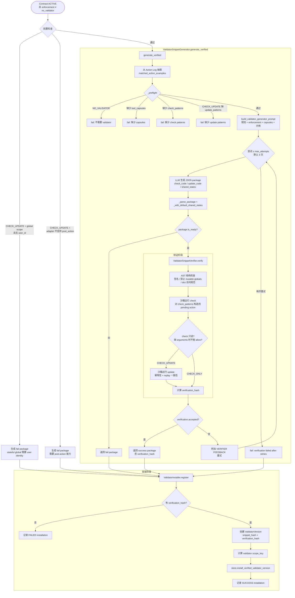
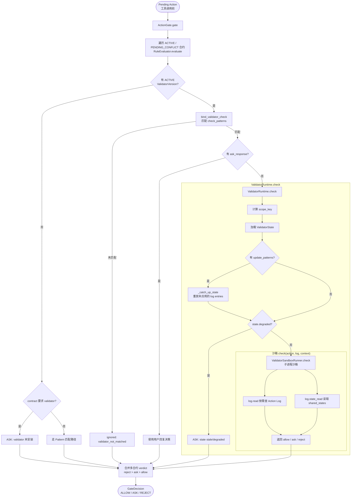
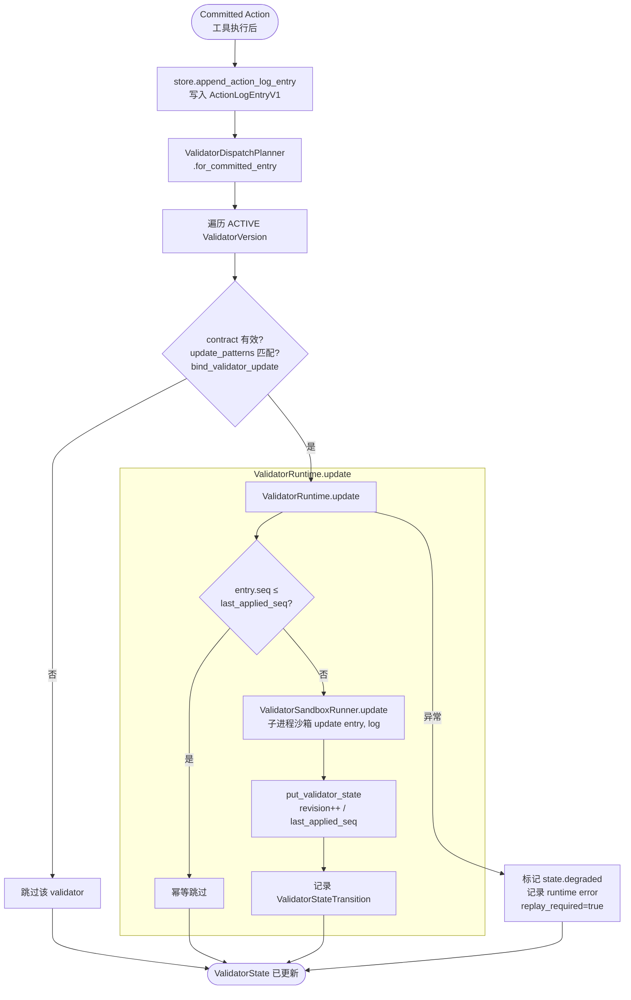
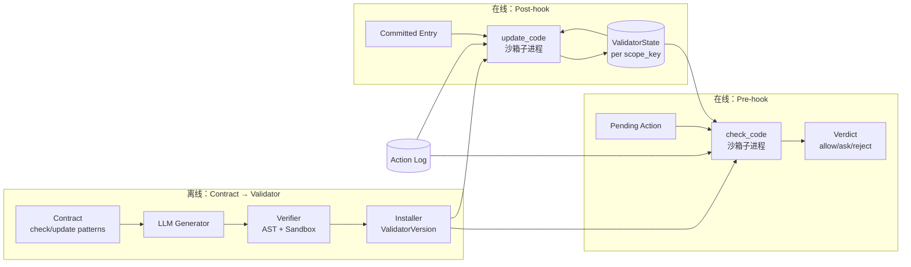

# Validator Flow

Validator 生命周期分两条主线：**安装/生成**（Contract 激活后）和 **运行时执行**（工具调用前后）。

主要代码入口：

| 阶段 | 模块 | 类/函数 |
|------|------|---------|
| 生成 | `validator_generation.py` | `ValidatorSnippetGenerator.generate_verified` |
| 验证 | `validator_installation.py` | `ValidatorSnippetVerifier.verify` |
| 安装 | `validator_installation.py` | `ValidatorProvisioner.provision` → `ValidatorInstaller.register` |
| Pre-hook | `validators.py` + `rule_evaluation.py` | `ValidatorRuntime.check` |
| Post-hook | `validators.py` + `validator_dispatch.py` | `ValidatorRuntime.update` |

---

## 1. Validator 安装流程（Provisioning）

Contract 变为 `ACTIVE` 且需要 validator 时，由 `MacHookRuntime.resolve_and_store` 触发 `ValidatorProvisioner.provision`。

---

## 2. 运行时 Pre-hook（工具调用前 Gate）

Agent 发起工具调用时，`ActionGate` → `RuleEvaluator` → `ValidatorRuntime.check`。

---

## 3. 运行时 Post-hook（工具调用后 Update）

工具执行完成并 commit 后，`ValidatorRuntime.record_committed_action` 触发状态更新。

---

## 4. 整体架构（一图总览）

---

## 关键设计点

| 阶段 | 入口 | 核心产物 |
|------|------|----------|
| 生成 | `ValidatorSnippetGenerator.generate_verified` | `check_code` + 可选 `update_code` + `shared_states` |
| 验证 | `ValidatorSnippetVerifier.verify` | `verification_hash`（安装必需） |
| 安装 | `ValidatorInstaller.register` | `ValidatorVersion` 写入 store |
| Pre-hook | `ValidatorRuntime.check` | `ValidatorVerdict`（allow/ask/reject） |
| Post-hook | `ValidatorRuntime.update` | 按 `scope_key` 维护 `ValidatorState` |

### Enforcement shape 差异

- **`check_only`**：只有 `check_code`，无状态更新
- **`check_update`**：pre 用 `check`，post 用 `update` 维护 `shared_states`
- **`no_validator`**：跳过整个 validator 流程

### Hook 职责

- **`check_code`**：在 pending tool action 执行前运行，决定该 action 是否满足 contract；可用 `log.state_read` 读取状态，但不能写状态
- **`update_code`**：在 committed tool action 之后运行，通过 `log.state_read` / `log.state_write` 更新既有 `shared_states` key；必须幂等

### 沙箱约束

- 子进程隔离运行（`ValidatorSandboxRunner`）
- 仅允许 `import math` / `import re`
- 通过 `log.read(spec)` 查询 Action Log，不支持 raw SQL
- 通过 `log.state_read(...)` / `log.state_write(...)` 读写已声明的 shared state key
- Verdict API：`allow()` / `ask()` / `reject()`
